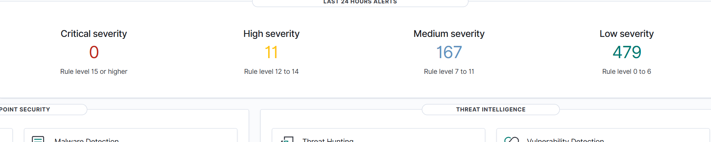
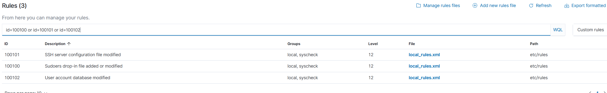

# Wazuh m-SOC

A small home-lab SOC: a Wazuh agent on an Ubuntu server sends events to a Wazuh manager, and three custom rules raise High alerts when sensitive files change.

Everything here was tested in my own lab with changes I triggered myself.

## Setup

- Wazuh 4.14.9, all-in-one on one VM (manager, Indexer, dashboard), built from the official OVA
- One agent on an Ubuntu VM, reading the systemd journal and running FIM (file integrity monitoring)

## Custom rules

| ID | Level | What it catches | MITRE |
|----|-------|-----------------|-------|
| 100100 | 12 | File added or changed in `/etc/sudoers.d/` | T1548.003 |
| 100101 | 12 | `/etc/ssh/sshd_config` changed | T1562.001 |
| 100102 | 12 | `/etc/passwd` or `/etc/shadow` changed | T1136.001 |

Rules: [`rules/local_rules.xml`](rules/local_rules.xml)
Agent FIM change (realtime for `/etc`): [`agent-config/ossec-syscheck-snippet.xml`](agent-config/ossec-syscheck-snippet.xml)

Dashboard times are UTC+5, the raw alert JSON is UTC.

## Reports

1. [SSH brute force](reports/01-ssh-bruteforce.md)
2. [Sudoers drop-in change](reports/02-sudoers-change.md)
3. [SSH config and account changes](reports/03-ssh-config-and-account-changes.md)

## Troubleshooting

Problems I ran into while building this and how I fixed them: [`docs/troubleshooting.md`](docs/troubleshooting.md)
