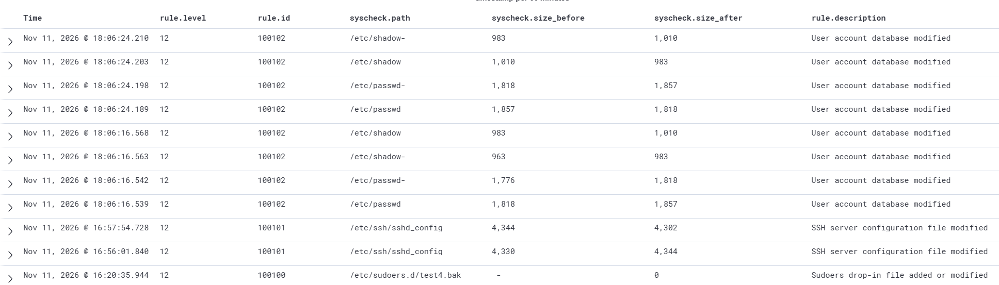

# Report 03: SSH config and account database changes (rules 100101, 100102)

## What they detect
| Rule | Watches | MITRE |
|------|---------|-------|
| 100101 | /etc/ssh/sshd_config modified | T1562.001 (Disable or Modify Tools) |
| 100102 | /etc/passwd or /etc/shadow modified | T1136.001 (Create Account: Local Account) |

Both build on built-in rule 550 (checksum changed) because the files already
exist and only their change matters. Level 12 (High): **Since admins change this file too, change is SUSPICIOS, but its not a guranteed compromise!**

## Why it matters
- sshd_config: weakening it (enable password login, permit root) lowers the
server's defenses.
- passwd / shadow: a new account is a classic way to keep access after the
original entry point is closed (persistence).

## How I tested

1)  Made a harmless change to sshd_config (a comment line), then
restored the original file. The rule fired on both changes.

2) Created a temporary test user with useradd and removed it with
userdel. The rule fired on both actions. The test user was removed afterwards.

Some extra alerts (noise) appeared along the way, for example from the system's
automatic backup copies of these files.

## Evidence

*Dashboard times are UTC+5; raw JSON is UTC.*

## What an analyst would do next
1. Who changed the file and when? Correlate with sudo and login events.
2. For passwd: which account is new, does it have UID 0, which shell?
3. For shadow: did a service account (* in the password field) get a password hash?
4. For sshd_config: diff against the known-good config; check PasswordAuthentication, PermitRootLogin.
5. Check for a change ticket. If none, treat as an incident.
